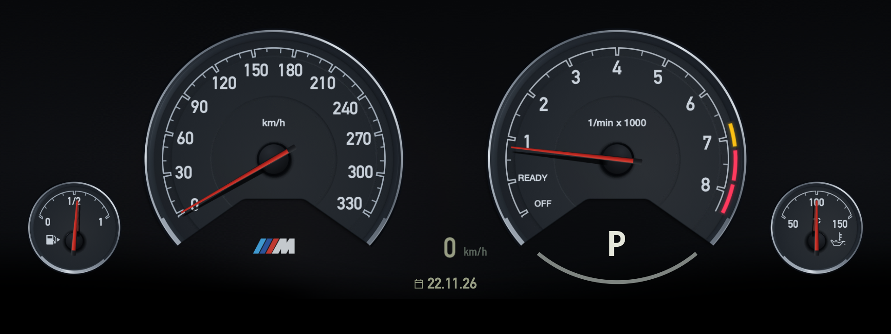

# Samagotia Clusters

Standalone BMW iDrive 7 instrument-cluster app featuring **F8X**. App ID: `samagotia_clusters`.



## MGU Store installation

This is a parked-test prerelease. Requires MGU Store already installed and **cluster-render 0.5.3 or later**. This repository does not enable SSH or install the Store on a stock car.

Add this GitHub repository as a source in MGU Store. The binary catalog is:

`https://github.com/samagotia/idrive7/releases/download/catalog/catalog.json`

The app starts with the **BMW cluster** selected and demo data off on the car. Select F8X only while parked for initial checks. Missing/stale speed or RPM, or renderer disconnection, returns to BMW and requires manual reselection. Live readers are source mapped; G82 reception, cold-limit tracking and native BMW warning takeover remain unverified on the car.

## Parked-test update 0.16.9

Shift lights and the lower arc now use cached resident images by default, replacing their procedural fragment shaders. Lamp colours, bloom and dynamic positions are retained. Both bloom variants preload; buildup and flashing change visibility without per-frame pixel uploads. **Performance → Lamp drawing** retains the original shaders for a parked comparison.

**Performance → RPM needle motion** defaults to **Measured**. Optional **Smooth (visual estimate)** adds tightly bounded movement between sparse rising RPM samples, only with fresh forward-gear and pedal data. The visual lead cannot exceed one dial degree or 100 RPM and stops on shifts, lift, invalid/stale input or congestion. It never changes raw readings, digital information, engine limits or shift decisions.

The Performance page separates received readings, changed readings and app command timing. These counters do not measure display FPS or sensor-to-screen latency. Actual car GPU improvement remains unmeasured. [Implementation and comparison](docs/performance-0.16.9.md).

The 0.16.8 sizes and wider spacing remain unchanged in Day and Night. BMW startup, car demo-off policy, stale speed/RPM fallback and the bottom-strip comparison option remain active. [Parked comparison instructions](docs/native-m-boxes-parked-test.md).

## Mac preview

With Node.js and Python 3 installed:

```sh
node bench/server.js samagotia_clusters
```

Open http://127.0.0.1:8078/ or double-click **Start Preview.command**. Every vehicle reading here is simulated; no car connection is made.

## Build and test

```sh
python3 tools/build_clusters.py --out dist/releases --repo samagotia/idrive7
python3 tools/build_clusters.py --stage-only
for test in bench/test*.js; do node "$test" || exit 1; done
```

The builder creates a local staging placeholder and removes it before packaging. No BMW SDK, private keys, coding backups or personal preview settings are distributed. The Store supplies the real SDK on the head unit.

Original licences and credits are preserved in [NOTICE](NOTICE) and [LICENSE](LICENSE), including MPL-covered renderer-client source in `shared/cluster_render_client.js`. Full features and limitations: [app documentation](apps/samagotia_clusters/README.md). [Local validation](docs/validation-0.16.9.json).
